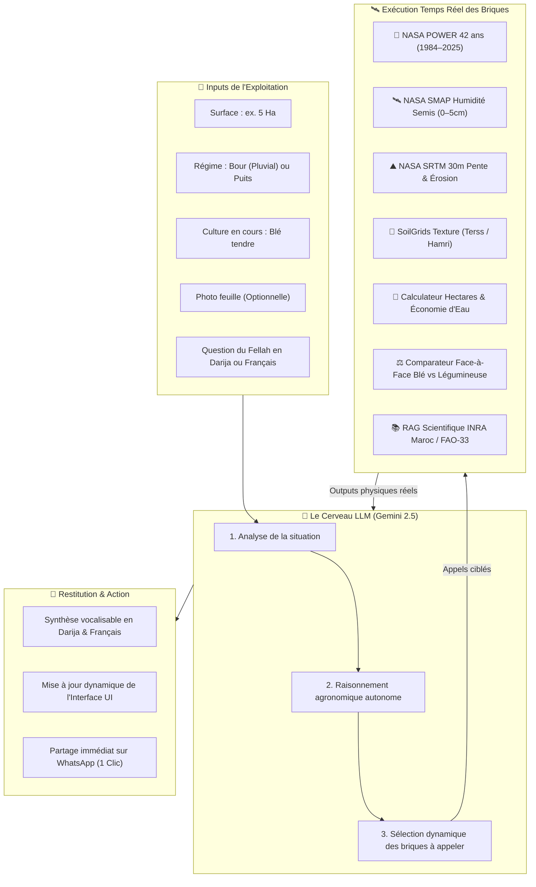

# 🌍 EarthEyes — Agent Agronome & Adaptation Climatique
### *NASA Space Apps Challenge 2026 — Édition Locale Meknès (Plaine du Saïss)*

> **« Ce n'est pas la terre qui manque au Saïss, c'est l'eau. »**  
> EarthEyes transforme 42 ans de données satellitaires de la NASA en décisions agricoles tangibles pour les petits exploitants marocains, directement en **Darija marocaine** et en **Français**, avec des unités réelles (**Quintaux**, **mètres cubes d'eau sauvés**, **Dirhams économisés**).

[](http://127.0.0.1:8000)
[-0284c7?style=for-the-badge&logo=NASA&logoColor=white)](https://power.larc.nasa.gov/)
[-38bdf8?style=for-the-badge&logo=NASA&logoColor=white)](https://smap.jpl.nasa.gov/)
[](https://www2.jpl.nasa.gov/srtm/)
[](https://ai.google.dev/)
[-10b981?style=for-the-badge)](#-banc-dessai--validation-technique)

---

## 🧭 Sommaire Psychologique & Visuel

1. [Le Problème Réel du Saïss](#-1-le-problème-réel-du-saïss-la-vérité-du-terrain) *(Pourquoi ce projet existe)*
2. [La Rupture : L'Agent LLM comme « Cerveau »](#-2-la-rupture-technologique--le-llm-est-le-cerveau-dans-la-boucle) *(Comment l'IA pilote la décision)*
3. [La Boîte à Outils Scientifique](#-3-la-boîte-à-outils-scientifique-8-briques-coordonnées) *(Les 8 briques physiques et spatiales)*
4. [L'Expérience Conçue pour le Fellah](#-4-lexpérience-conçue-pour-le-fellah-marocain) *(Zéro jargon, 100% pragmatique)*
5. [Architecture & Flux de Données](#-5-architecture-technique--flux-décisionnel) *(Schéma complet)*
6. [Preuves Chiffrées & Comparatif](#-6-preuves-chiffrées--comparatif-blé-vs-légumineuses) *(Face-à-face agronomique)*
7. [Démarrage Rapide (60 secondes)](#-7-démarrage-rapide-en-60-secondes) *(Commandes prêtes à l'emploi)*

---

## 🚨 1. Le Problème Réel du Saïss (La Vérité du Terrain)

Dans la plaine de **Meknès / Saïss**, cœur céréalier et légumier du Maroc, les agriculteurs subissent une triple crise documentée par l'Agence du Bassin Hydraulique du Sebou (ABHS) et l'INRA :

```
🔴 -1,0 à -1,5 mètre par an : Baisse tendancielle alarmante de la nappe phréatique du Saïss.
🔴 -22% de pluie au printemps : Sécheresse récurrente au moment critique du remplissage du grain.
🔴 Monoculture du blé épuisante : Les sols s'appauvrissent en azote, la septoriose prolifère dans les pailles,
   et les fellahs hésitent à changer de culture par peur du risque financier.
```

### Le Paradoxe de la Donnée
La NASA dispose de téraoctets de données satellitaires exceptionnelles (satellites POWER, SMAP, SRTM). **Mais un fellah ne lit ni un GeoTIFF, ni un script Python, ni une moyenne abstraite en millimètres.**

> **La Mission d'EarthEyes :**  
> Créer un **Agent Agronome Autonome** qui prend en compte les inputs réels de la ferme (surface en hectares, eau pluviale *Bour* ou puits *Saqwi*, culture actuelle, maladie foliaire) et orchestre lui-même les satellites pour répondre aux vraies questions :
> - *« Wach l'ard wajda l z-zri3a ? »* (La terre est-elle prête au semis ?)
> - *« Chno n-zre3 mor l-gezza bach n-waffer l-ma o n-rb7 l-azot ? »* (Que planter après le blé pour préserver l'eau et gagner de l'azote ?)
> - *« Ch7al mn qentar ghadi n-jme3 f 5 hectares dyali ? »* (Combien de quintaux vais-je récolter sur mes 5 hectares ?)

---

## 🧠 2. La Rupture Technologique : Le LLM est le « Cerveau » dans la Boucle

Contrairement aux chatbots passifs ou aux formulaires classiques à règles rigides, **EarthEyes place le modèle de langage au poste de commandement (Cerveau)** :



### Ce qui change tout :
1. **Zéro règle en dur :** Si le fellah parle de son terrain en pente, l'Agent appelle automatiquement **NASA SRTM 30m**. S'il mentionne sa surface (ex: 8 hectares), il appelle le **calculateur d'exploitation**. S'il hésite entre le blé et le pois chiche, il appelle le **comparateur face-à-face**.
2. **Double passage raisonné :** Le Cerveau planifie $\rightarrow$ les briques scientifiques calculent $\rightarrow$ le Cerveau analyse les résultats physiques réels et rédige le conseil.
3. **Haute vitesse & Résilience :** Architecture REST directe avec basculement automatique de modèle (réponse en **5 à 6 secondes** chrono, sans blocage).

---

## 🔬 3. La Boîte à Outils Scientifique (8 Briques Coordonnées)

EarthEyes ne fait pas de promesses en l'air (*zéro vaporware*). Chaque outil repose sur une brique de physique agronomique éprouvée :

| Outil & Satellite | Ce qu'il mesure concrètement | Impact direct pour l'agriculteur |
| :--- | :--- | :--- |
| **🌾 NASA POWER 42 ans**<br>`step7_rotation/` | Ingestion des séries agroclimatiques 1984–2025 (42 saisons réelles). Prouve scientifiquement le **+1,2°C** et la baisse de **-22%** des pluies printanières au Saïss. | Calcule les distributions de rendement (**P10, P50, P90**) en kg/ha et quintaux/ha, ainsi que le **Win Rate %** (taux de victoire de la culture face au blé en année sèche). |
| **🛰️ NASA SMAP L3/L4**<br>`step2_soil/` | Radiométrie micro-ondes passive mesurant l'humidité superficielle (0–5 cm) du sol. Calibré sur la plage optimale du Saïss : **12% à 18%**. | Indique si la terre est prête pour le semis (*Wach l-ard wajda*). Évite de semer en sol trop sec ou détrempé. |
| **⛰️ NASA SRTM 30m**<br>`step7_rotation/` | Modèle numérique d'altimétrie radar à 30 mètres de résolution spatiale. | Calcule la pente exacte (%) de la parcelle et le risque de ravinement. Recommande le labour en courbes de niveau (*7ret f l-3ard*). |
| **🧪 ISRIC SoilGrids v2.0**<br>`step2_soil/` | Granulométrie (Argile, Sable, Limon), pH (H₂O) et Carbone Organique du sol à 0–30 cm. | Distingue les vertisols lourds du Saïss (**Terss**, argile > 35%) des sols rouges légers (**Hamri**). Guide le choix variétal et la profondeur d'enracinement. |
| **🌿 Sentinel-2 & MODIS**<br>`step3_satellite/` | Réflectance proche infrarouge et rouge (NDVI) via Google Earth Engine. | Mesure la vigueur foliaire active de la parcelle et détecte les anomalies végétatives précoces. |
| **🚜 Calculateur d'Exploitation**<br>`step7_rotation/` | Multiplicateur par la surface exacte en hectares ($H$) et le régime hydrique (*Bour* pluvial vs *Saqwi* puits). | Calcule la récolte totale en **Quintaux (*Qentar*)**, la semence requise (*Zzerri3a*), le volume d'eau sauvé ($m^3$) et les Dirhams d'engrais épargnés. |
| **⚖️ Comparateur Face-à-Face**<br>`step7_rotation/` | Confrontation directe Blé continu vs Légumineuse alternative. | Met en évidence les 5 critères clés : eau consommée, azote (+35 kg/ha vs -60 kg/ha), rupture de la septoriose, résistance sécheresse, et note du sol. |
| **📚 RAG INRA / FAO / ICARDA**<br>`step5_llm/` | Base documentaire indexée (INRA Meknès Bulletin n°42, directives FAO-33, fiches ICARDA). | Fournit la caution scientifique officielle et les explications en Darija marocaine sur la symbiose rhizobienne et l'efficience de l'eau. |

---

## 👨‍🌾 4. L'Expérience Conçue pour le Fellah Marocain

L'interface web (`templates/index.html`) a été épurée et pensée selon les principes de **psychologie cognitive** pour éliminer toute friction d'usage :

```
┌─────────────────────────────────────────────────────────────────────────────┐
│ 🚜 SURFACE RAPIDE :   [ 2 Ha ]   [ 5 Ha (Actif) ]   [ 10 Ha ]   [ ___ Ha ]   │
│ 💧 RÉGIME HYDRIQUE :  [ 🌧️ Bour (Pluvial) ]    [ 💧 Saqwi (Puits / Irrigué) ]│
└─────────────────────────────────────────────────────────────────────────────┘
```

1. **La Langue Naturelle :** L'Agent dialogue couramment en **Darija marocaine (arabizi ou caractères arabes)** et en **Français**, avec des métaphores agronomiques locales (*« L-7emmez kay-fiyyeq l-ard o kay-3emmerha b l-azot »*).
2. **La Dictée Vocale (🎙️) :** Un bouton micro dans la barre de discussion permet au fellah de parler directement sans clavier via l'API Web Speech (`ar-MA` / `fr-FR`).
3. **Le Partage WhatsApp en 1 Clic (📲 *Sifet f WhatsApp*) :** Un bouton direct génère un message pré-formaté avec les chiffres clés (quintaux, m³ d'eau sauvés, Dirhams économisés) pour l'envoyer instantanément à sa famille ou à sa coopérative.
4. **Des Unités Tangibles :** Aucun chiffre abstrait. On parle en **Quintaux (*Qentar*)**, en **sacs d'ammonitrate gratuits** et en **Dirhams de pompage économisés**.

---

## ⚖️ 5. Preuves Chiffrées : Comparatif Blé vs Légumineuses

Simulation réelle calculée sur **42 saisons historiques (1984–2025)** de la plaine du Saïss :

| Critère Agronomique | ❌ Monoculture de Blé (Statu Quo) | ✅ Pois Chiche (*L-7emmez*) | ✅ Féverole (*L-Foul*) |
| :--- | :---: | :---: | :---: |
| **Rendement estimé** | 2 600 kg/ha (26 q/ha) | **1 570 kg/ha (15.7 q/ha)** | **2 060 kg/ha (20.6 q/ha)** |
| **Consommation en eau** | 4 200 m³/ha | **2 400 m³/ha** *(Économie : -1 800 m³)* | **3 200 m³/ha** *(Économie : -1 000 m³)* |
| **Productivité de l'eau (FAO-33)** | 0,62 kg de grain / m³ | **0,65 kg de grain / m³** | **0,64 kg de grain / m³** |
| **Bilan Azote du Sol** | Épuisement (-60 kg N/ha) | **+35 kg N/ha d'azote naturel** | **+45 kg N/ha d'azote naturel** |
| **Rupture Parasitaire** | ❌ Maintient la Septoriose et le Piétin | **✅ Casse net le cycle des champignons** | **✅ Aère la semelle des sols argileux** |
| **Résilience Sécheresse (*Win Rate*)** | 35% en climat récent | **74% des saisons devant le blé** | **70% des saisons devant le blé** |
| **Score Santé du Sol** | 35 / 100 | **92 / 100** | **95 / 100** |

---

## 🏗️ 6. Architecture Technique & Structure du Code

```
earth-eyes/
├── app.py                          # Point d'entrée serveur FastAPI
├── main.py                         # Passerelle API, endpoints (/chat, /recommend-rotation, /predict)
├── templates/
│   └── index.html                  # Interface bilingue, carte Leaflet, dictée vocale, WhatsApp
├── presentation/                   # Deck de présentation 7 slides interactif pour le jury
├── step1_disease/                  # Vision foliaire (Gemini Multimodal + Masquage HSV sévérité)
│   └── predict.py
├── step2_soil/                     # Données sol & humidité NASA
│   ├── smap_soil.py                # NASA SMAP L3/L4 humidité au semis (0–5cm)
│   └── soil_api.py                 # SoilGrids ISRIC (argile, sable, pH, Terss/Hamri)
├── step3_satellite/                # Imagerie multispectrale Sentinel-2 / MODIS
│   └── satellite_ndvi.py           # Calcul de l'indice NDVI par GEE
├── step4_simulation/               # Modèle biophysique de culture WOFOST
│   └── simulation_runner.py
├── step5_llm/                      # Le Cerveau IA Central
│   ├── agronomic_agent.py          # Agent Autonome Multi-Outils (Cerveau de décision)
│   ├── rag_agronomy.py             # RAG scientifique INRA Maroc (Bulletin n°42) & FAO
│   └── llm_service.py              # Connecteur modèles Gemini
├── step6_ml/                       # Fusion prédictive Random Forest
│   └── yield_predictor.py
├── step7_rotation/                 # Moteur d'adaptation climatique & rotation NASA POWER
│   ├── rotation_engine.py          # Simulation 42 saisons (1984–2025) & distributions P10/P50/P90
│   ├── crop_catalog.py             # Catalogue agronomique Saïss (Blé, Pois chiche, Féverole, Orge)
│   ├── terrain_slope.py            # NASA SRTM 30m altitude, pente et anti-érosion
│   ├── water_productivity.py       # Efficience physique de l'eau (FAO-33) & économie nappe
│   └── nasa_climate_client.py      # Client API NASA POWER avec mise en cache locale
└── tests/
    ├── test_complete_application.py # Banc d'essai automatisé couvrant 100% des endpoints
    └── test_new_chat_features.py    # Tests unitaires des actions agentiques
```

---

## ⚡ 7. Démarrage Rapide en 60 Secondes

### 1. Cloner et installer les dépendances
```bash
git clone https://github.com/NasaChallenge-earth-eyes/earth-eyes.git
cd earth-eyes
pip install -r requirements.txt
```

### 2. Configurer la clé Gemini
Créez un fichier `.env` à la racine :
```env
GEMINI_API_KEY="votre_cle_api_gemini"
```

### 3. Lancer l'application
```bash
python -m uvicorn app:app --host 127.0.0.1 --port 8000
```

### 4. Accéder aux interfaces
| URL | Description |
| :--- | :--- |
| **`http://127.0.0.1:8000/`** | **Interface Agriculteur complète** (Bilingue, Télémétrie NASA, Agent IA, Voice, WhatsApp) |
| **`http://127.0.0.1:8000/presentation`** | **Pitch Deck 7 Slides** interactif pour le jury NASA Space Apps |
| **`http://127.0.0.1:8000/docs`** | Documentation interactive OpenAPI / Swagger des endpoints |

---

## 🧪 8. Banc d'Essai & Validation Technique

Le projet intègre une suite de tests automatisés vérifiant en conditions réelles l'ensemble des endpoints de l'application :

```bash
python tests/test_complete_application.py
```

```
======================================================================
  🏆 RÉSULTAT DU BANC D'ESSAI : 7/7 TESTS VALIDÉS AVEC SUCCÈS !
======================================================================
  ✅ TEST 1 : GET / -> 200 OK (Interface principale chargée)
  ✅ TEST 2 : GET /presentation -> 200 OK (Deck interactif de 7 slides)
  ✅ TEST 3 : POST /recommend-rotation -> 200 OK (Top 1: Pois chiche 15.7 q/ha, Sol 92/100)
  ✅ TEST 4 : GET /recommend-rotation -> 200 OK (Fallback de résilience validé)
  ✅ TEST 5 : POST /chat -> 200 OK (Agent Cerveau : Rotation, SMAP, SRTM, Hectares)
  ✅ TEST 6 : POST /agent-upload-photo -> 200 OK (Vision IA & Rupture sanitaire sol)
  ✅ TEST 7 : POST /predict -> 200 OK (Pipeline complet 6 étapes : Sol, NDVI, WOFOST, ML)
======================================================================
```

---

## 🌟 La Vision Humaine & Souveraine

EarthEyes ne cherche pas à remplacer l'agriculteur. Il lui redonne le **pouvoir de décider sereinement face à l'incertitude du climat**.  
En croisant la télémétrie satellitaire de la NASA avec la sagesse agronomique de l'INRA Maroc et la langue maternelle des producteurs du Saïss, nous transformons des pixels orbitaux en prospérité rurale durable.

*NASA International Space Apps Challenge 2026 · Meknès, Maroc.*
