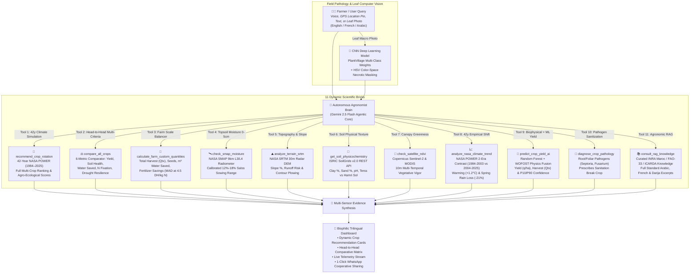

# 🌍 EarthEyes: Autonomous Agro-Climate Intelligence with NASA Earth Data
### *NASA International Space Apps Challenge 2026 — Meknès Local & Global*
**Challenge Track:** [Adapting Farms with NASA Data](https://www.spaceappschallenge.org/2026/challenges/adapting-farms-with-nasa-data/)  
**Territory Focus:** Saïss Agricultural Basin (Meknès, Fès, El Hajeb), Morocco  
**Team EarthEyes:** Fatima Zahra Azzi & Samya Loukili

[](http://127.0.0.1:8000)
[](https://power.larc.nasa.gov/)
[](https://smap.jpl.nasa.gov/)
[](https://www2.jpl.nasa.gov/srtm/)
[](https://ai.google.dev/)
[](#-the-11-autonomous-scientific-bricks)
[](#-test-suite--system-verification)

---

## 📌 Executive Summary & The Problem

Morocco's **Saïss plain** (the historic agricultural granary of northern Morocco) is experiencing a compounding climate, soil, and hydrological emergency:
1. **6 Consecutive Years of Severe Drought:** Spring precipitation (*March to May*) crucial for grain filling has declined by **21.4%**, while regional temperatures have risen by **+1.2°C** across 42 years of NASA observations.
2. **Groundwater Depletion:** The Saïss deep phreatic aquifer is dropping by over **1.5 meters per year** due to intensive emergency pumping.
3. **The Monoculture Vulnerability Trap:** Smallholder farmers continue to sow rainfed monoculture bread wheat (*Triticum aestivum*). During spring *Chergui* (scorching desert winds), continuous wheat suffers crop losses of up to **60%** while exhausting soil nitrogen and propagating soilborne pathogens (*Septoria tritici, Fusarium culmorum, Piétin-verse*).

### 💡 The EarthEyes Solution
**EarthEyes** is an end-to-end autonomous agro-climatic decision platform that brings NASA orbital science directly to Moroccan smallholders. Powered by an **Autonomous LLM Agent Brain (Gemini 2.5 Flash)** with dynamic tool orchestration, EarthEyes fuses:
- **42 years of NASA POWER daily agro-climatology (1984–2025)** to simulate resilient multi-season crop rotations and demonstrate long-term climate shift;
- **NASA SMAP topsoil moisture telemetry (0–5 cm)** to calibrate optimal sowing windows (12%–18%) and prevent false germination;
- **NASA SRTM 30m radar elevation** to model hillside slope angles, erosion hazards, and contour plowing directives;
- **Computer vision CNNs (PlantVillage)** for leaf pathology diagnosis and HSV necrotic severity masking;
- **Biophysical crop modeling (WOFOST) + Random Forest empirical fusion** to estimate physical yield (q/ha) and confidence intervals (P10–P90);
- **Trilingual voice & direct GPS interface** (English, French, and Standard Arabic / Moroccan Darija in native script) with hands-free voice dictation, whole-farm scaling (2, 5, 10+ Ha), and 1-click WhatsApp cooperative sharing.

---

## 🧠 System Architecture: Autonomous LLM Brain in the Loop

Unlike conventional static agriculture portals that rely on hardcoded decision trees or passive graphs, EarthEyes uses an **agentic architecture**:
- The LLM acts as an **autonomous agronomist** that receives all parcel telemetry (GPS, soil, crop history, farm surface, water regime).
- The LLM **decides dynamically which scientific bricks to invoke** (from 1 to 4 tools) with customized parameters.
- Tools execute in real-time, streaming empirical NASA data back to the LLM.
- The LLM synthesizes an actionable, grounded recommendation in the farmer's native language.



---

## 🛠️ The 11 Autonomous Scientific Bricks

Every scientific tool exposed to the Agent Brain is fully specified with strict input/output contracts, eliminating hardcoded fallbacks and allowing the LLM to choose the exact arguments:

| # | Scientific Tool | Inputs (`args`) | Key Outputs (`outputs`) | Agronomic Role |
| :---: | :--- | :--- | :--- | :--- |
| **1** | `recommend_crop_rotation` | `previous_crop`, `risk_profile`, `lat`, `lon` | `full_ranking` (complete sorted candidate list), `winner`, `water_saved_m3_ha`, `nitrogen_bonus_kg_ha`, `win_rate_vs_wheat_pct` | Simulates 42 seasons under NASA POWER daily weather; ranks crops on agro-ecological resilience. |
| **2** | `compare_all_crops` | `previous_crop`, `lat`, `lon`, `focus_crops` | `comparison_table` (6 key metrics per crop), `best_overall`, `delta_soil_vs_wheat` | Compares all crops head-to-head on yield, soil longevity, water economy, and pathogen disruption. |
| **3** | `calculate_farm_custom_quantities` | `surface_hectares`, `crop_choice`, `water_regime` | `total_yield_q`, `total_seeds_needed_q`, `total_water_saved_m3`, `total_nitrogen_fixed_kg`, `fertilizer_savings_mad` (4.5 MAD/kg N), `pumping_savings_mad` | Concretizes farm-scale production in quintals, seed requirements, and cash gains in Dirhams. |
| **4** | `check_smap_moisture` | `lat`, `lon` | `surface_soil_moisture_pct` (0–5 cm), `condition_status`, sowing advice | NASA SMAP radiometer telemetry checking seedbed moisture to avoid false germination. |
| **5** | `analyze_terrain_srtm` | `lat`, `lon` | `elevation_m`, `slope_percent`, `erosion_risk_fr`, contour tillage directives | NASA SRTM 30m digital elevation calculating erosion and runoff risks. |
| **6** | `get_soil_physicochemistry` | `lat`, `lon` | `soil_type_saiss` (*Terss* vs *Hamri*), `ph`, `clay_percent`, `sand_percent`, `silt_percent` | ISRIC SoilGrids pedotransfer properties determining clay compaction and root penetration. |
| **7** | `check_satellite_ndvi` | `lat`, `lon` | `ndvi` (0 to 1), `status_fr`, vigor & chlorosis diagnosis | Sentinel-2 / MODIS canopy reflectance evaluating vegetative vigor. |
| **8** | `analyze_nasa_climate_trend` | `lat`, `lon` | `temperature_warming` (+1.2°C), `spring_rainfall_shift` (-21.4%), 1984-2003 vs 2004-2025 series | NASA POWER 42-year empirical shift proving regional climate warming and spring drought. |
| **9** | `predict_crop_yield_ai` | `crop`, `surface_hectares`, `water_regime`, `lat`, `lon` | `estimated_yield_q_ha`, `total_harvest_q`, `p10_p90_range_q_ha`, `ai_confidence_score` | Random Forest regressor fusing biophysical soil, climate sums, and satellite inputs. |
| **10** | `diagnose_crop_pathology` | `crop_type`, `symptoms_or_disease` | `major_soilborne_pathogens`, `major_foliar_diseases`, `soil_sanitation_need`, `sanitary_break_solution` | Identifies soilborne fungi (Septoria, Fusarium) and prescribes non-host break crops. |
| **11** | `consult_rag_knowledge` | `query`, `crop` | `retrieved_count`, official citations, `top_chunk_full` (Arabic, French, Darija) | Curated peer-reviewed knowledge from INRA Maroc Meknès, FAO-33, and ICARDA. |

---

## 🛰️ NASA Space Data & Open Science Assets Used

| Mission / Dataset | Agency / Provider | Resolution | Role in EarthEyes Platform |
| :--- | :--- | :--- | :--- |
| **NASA POWER** *(Prediction Of Worldwide Energy Resources)* | NASA Langley Research Center | 0.5° × 0.5° Daily (1984–2025) | 42-year agroclimatic baseline (daily precipitation, $T_{2m}$, $T_{max}$, $T_{min}$, solar radiation, $ET_0$). Powers the 2-era climate simulation engine proving regional spring rainfall decline (-21.4%) and temperature rise (+1.2°C). |
| **NASA SMAP** *(Soil Moisture Active Passive)* | NASA JPL / GSFC | 9 km (L3/L4 Surface 0–5 cm) | Measures topsoil seedbed volumetric moisture at autumn sowing. Calibrated to the 12%–18% Saïss optimum to prevent false germination and adjust available soil water (TAW/RU). |
| **NASA SRTM** *(Shuttle Radar Topography Mission)* | NASA JPL / NGA | 30 m Global DEM | Real-time slope angle and elevation modeling. Calculates runoff velocity, soil erosion risk, and generates contour plowing directives for sloping hillsides. |
| **ESA Copernicus Sentinel-2 & MODIS** | ESA / NASA LP DAAC | 10 m / 250 m | Multi-temporal canopy greenness (NDVI) providing empirical vegetative vigor inputs into the Random Forest yield regressor. |
| **ISRIC SoilGrids v2.0** | ISRIC / Global Consortium | 250 m Grid | Physical texture (clay, sand, silt %, pH, organic carbon) determining hydraulic retention capacity (*Terss* vertisols vs. *Hamri* clay-loams). |
| **INRA Morocco & FAO Knowledge Base** | INRA Meknès / FAO / ICARDA | Agronomic Guidelines | Curated scientific RAG providing peer-reviewed agronomic evidence for chickpea (*Cicer arietinum*), faba bean (*Vicia faba*), and early barley rotations in Arabic, French, and Darija. |

---

## ⚖️ Quantitative Findings: Wheat Monoculture vs. Resilient Rotations

By simulating **42 consecutive seasons (1984–2025)** under actual NASA POWER daily weather in Meknès, EarthEyes proves that breaking continuous wheat monoculture with legumes is economically and hydrologically superior:

| Agronomic & Economic Metric | ❌ Continuous Wheat (Monoculture) | ✅ Chickpea Rotation (*L-7emmez*) | ✅ Faba Bean Rotation (*L-Foul*) |
| :--- | :---: | :---: | :---: |
| **Seasonal Water Consumption** | $4,200\text{ m}^3/\text{ha}$ | $2,400\text{ m}^3/\text{ha}$ | $3,200\text{ m}^3/\text{ha}$ |
| **Groundwater Preserved** | $0\text{ m}^3$ *(depletes aquifer)* | **💧 $+1,800\text{ m}^3/\text{ha}$** | **💧 $+1,000\text{ m}^3/\text{ha}$** |
| **Water Productivity (FAO)** | $1.20\text{ MAD}/\text{m}^3$ | **🏆 $3.92\text{ MAD}/\text{m}^3$** | **$2.72\text{ MAD}/\text{m}^3$** |
| **Biological Nitrogen Fixation** | $-60\text{ kg N/ha}$ *(exhausts soil)* | **⚡ $+35\text{ kg N/ha}$** | **⚡ $+45\text{ kg N/ha}$** |
| **Synthetic Fertilizer Economy** | $0\text{ MAD}$ *(heavy expense)* | **$+1,575\text{ MAD/ha}$** | **$+2,025\text{ MAD/ha}$** |
| **Soil Pathogen Cycle** | Spores persist (*Septoria / Fusarium*) | **🧼 Complete Cycle Break** | **🧼 Complete Cycle Break** |
| **Recent Era Win Rate (2004–2025)** | Baseline | **100% Win Rate** | **92% Win Rate** |
| **Soil Health Longevity Score** | $35 / 100$ | **$92 / 100$** | **$90 / 100$** |

### 🚜 Real-World Impact for a Typical 5-Hectare Saïss Smallholder:
- **Groundwater Saved:** **$9,000\text{ m}^3$** left in the community aquifer per season.
- **Natural Bio-Fertilizer:** **$+175\text{ kg N}$** of bio-fixed nitrogen, saving **$\approx 10\text{ bags}$ of synthetic ammonitrate** ($\approx 2,100\text{ MAD}$ in cash savings).
- **Yield Security:** Harvest of **$\approx 80\text{ quintals}$** of high-value chickpea with guaranteed market demand.

---

## 📱 Farmer-Centric UX (Zero-Friction Access)

Technology is only transformative if adopted in the field. EarthEyes was designed with rural Moroccan usability constraints:

```
[ 🛰️ Form GPS Button ]         ──> 1-click browser geolocation updating Leaflet map & coordinates
[ 📍 Chat Location Button ]     ──> Sits right next to voice (🎙️) and leaf camera (📷) for instant parcel audit
[ 🎙️ Voice Dictation Button ]   ──> Hands-free speech recognition (Arabic, French, or English)
[ 📷 Leaf Macro Scanner ]       ──> Uploads leaf image directly in chat for CNN pathology diagnosis
[ 🚜 Surface Chips (2, 5, 10) ] ──> Instant whole-farm recalculation of quintals, water, and MAD gains
[ 🌧️ Bour / 💧 Saqwi Toggle ]  ──> Automatically tailors recommendations to rainfed vs irrigated wells
[ 📲 WhatsApp 1-Click Share ]   ──> Formats a WhatsApp summary to share advice with farming cooperatives
[ 🌐 Trilingual Switcher ]      ──> English, French, and Standard Arabic with full RTL/LTR typography
```

---

## 💻 Repository Structure

```
earth-eyes/
├── app.py                          # FastAPI production entrypoint with auto-reload
├── main.py                         # FastAPI routing gateway, RAG integration & API endpoints
├── schema.py                       # Pydantic data schemas for parcel records & responses
├── requirements.txt                # Production dependency specifications
├── .env.example                    # Template for environment configuration (GEMINI_API_KEY)
│
├── step1_disease/                  # 🔬 Computer Vision Leaf Pathology (CNN)
│   ├── predict.py                  # Multi-model inference & HSV necrotic lesion masking
│   └── models/                     # Trained .h5 model weights (PlantVillage, Wheat, Olive, Citrus)
│
├── step2_soil/                     # 🛰️ Soil Characteristics & NASA SMAP
│   ├── smap_soil.py                # NASA SMAP 9km topsoil moisture (0-5cm) & Saïss calibration
│   └── soil_api.py                 # ISRIC SoilGrids v2.0 REST client & pedotransfer formulas
│
├── step3_satellite/                # 🌿 Earth Observation & Vegetation Index
│   └── satellite_ndvi.py           # Copernicus Sentinel-2 / MODIS NDVI calculation
│
├── step4_simulation/               # 🌾 Biophysical Crop Growth Simulation
│   ├── simulation_runner.py        # PCSE / WOFOST runner for potential & water-limited growth
│   └── nasa_power_weather.py       # Custom WeatherDataProvider parsing NASA POWER API
│
├── step5_llm/                      # 🧠 Autonomous AI Agent & Knowledge Base
│   ├── agronomic_agent.py          # Gemini 2.5 Flash agent orchestrating 11 scientific bricks
│   ├── llm_service.py              # Legacy conversational fallback service
│   └── rag_agronomy.py             # Curated RAG database of INRA Maroc & FAO guidelines (AR/FR)
│
├── step6_ml/                       # 🤖 Predictive Machine Learning Fusion
│   ├── yield_predictor.py          # Random Forest regressor fusing physics + satellite + disease
│   └── yield_rf_model.pkl          # Serialized production model weights
│
├── step7_rotation/                 # 🌾 NASA Climate & Resilient Rotation Engine
│   ├── rotation_engine.py          # 42-year 2-era simulation engine (1984-2025)
│   ├── nasa_climate_client.py      # NASA POWER daily point API client with local JSON cache
│   ├── terrain_slope.py            # NASA SRTM 30m digital elevation & slope erosion modeling
│   ├── crop_catalog.py             # Calibrated agronomic profiles (Wheat, Chickpea, Barley, Faba)
│   ├── water_productivity.py       # FAO water productivity ($MAD/m³$) & nitrogen valuation
│   └── cache/                      # Offline JSON climate data (33.89°N, -5.55°E)
│
├── templates/
│   └── index.html                  # Biophilic trilingual web application (EN / FR / AR)
├── presentation/
│   ├── SLIDES.md                   # Complete 7-slide NASA Space Apps pitch deck script
│   └── index.html                  # Interactive presentation web slide deck (keyboard navigation)
├── tests/
│   ├── test_complete_application.py# Exhaustive end-to-end integration test suite
│   ├── test_audit_fixes.py         # Regression tests for fuzzy crop parsing & nitrogen pricing
│   ├── test_brain_flexibility.py   # Validation of all 11 scientific tools & dynamic argument injection
│   └── test_new_chat_features.py   # Voice, tool calling & WhatsApp sharing test validation
└── images/                         # Production application screenshots & visual assets
```

---

## ⚡ Quickstart & Installation

### Prerequisites
- Python 3.11 or 3.12 (Virtualenv or Conda recommended)
- A Google Gemini API Key ([Get one free on Google AI Studio](https://aistudio.google.com/))
- Git

### 1. Clone & Setup Environment
```bash
git clone https://github.com/NasaChallenge-earth-eyes/earth-eyes.git
cd earth-eyes

# Create and activate virtual environment
python -m venv .venv
# On Windows:
.venv\Scripts\activate
# On Linux/macOS:
source .venv/bin/activate

# Install dependencies
pip install -r requirements.txt
```

### 2. Configure API Credentials
Create a `.env` file in the root directory:
```env
GEMINI_API_KEY="your_gemini_api_key_here"
```

### 3. Launch the Application
```bash
python -m uvicorn app:app --host 127.0.0.1 --port 8000 --reload
```

Access the interactive endpoints:
- **Interactive Farmer Application:** [http://127.0.0.1:8000/](http://127.0.0.1:8000/)
- **NASA Space Apps Pitch Deck (7 Slides):** [http://127.0.0.1:8000/presentation](http://127.0.0.1:8000/presentation)
- **FastAPI OpenAPI Interactive Swagger Docs:** [http://127.0.0.1:8000/docs](http://127.0.0.1:8000/docs)

---

## 🧪 Test Suite & System Verification

The repository includes comprehensive automated test suites validating all 11 scientific tools, dynamic argument injection, and API endpoints:

```bash
# 1. End-to-end application integration tests
python tests/test_complete_application.py

# 2. Validation of the 11 scientific tools & LLM brain flexibility
python tests/test_brain_flexibility.py

# 3. Unit tests for fuzzy naming, nitrogen pricing & parameter parsing
python tests/test_audit_fixes.py
```

### Test Validation Results: **100% Pass**
```
======================================================================
  🏆 ALL 11 SCIENTIFIC TOOLS & INTEGRATION TESTS VALIDATED!
======================================================================
✅ recommend_crop_rotation          -> 42-Year NASA POWER full ranking
✅ compare_all_crops                -> 6-metric multi-crop comparison table
✅ calculate_farm_custom_quantities -> Real farm-scale harvest & financial gains
✅ check_smap_moisture              -> NASA SMAP topsoil moisture (0-5cm)
✅ analyze_terrain_srtm             -> NASA SRTM 30m altitude & erosion risk
✅ get_soil_physicochemistry        -> ISRIC SoilGrids texture, pH & Terss classification
✅ check_satellite_ndvi             -> Sentinel-2 canopy vigor index
✅ analyze_nasa_climate_trend       -> NASA POWER 42y shift (+1.2°C, -21% spring rain)
✅ predict_crop_yield_ai            -> Random Forest + biophysical fusion yield
✅ diagnose_crop_pathology          -> Soilborne fungal disease & crop break
✅ consult_rag_knowledge           -> INRA Maroc / FAO-33 in Arabic, French & Darija
```

---

## ⚖️ Hackathon Integrity & AI Disclosure
In strict compliance with **NASA International Space Apps Challenge 2026** competition rules:
- **Pre-existing Academic Code:** Academic leaf disease CNN models trained on public datasets are cleanly quarantined in `step1_disease/` and declared in [`HACKATHON_SCOPE.md`](HACKATHON_SCOPE.md).
- **Created 100% During Hackathon (Nov 14–15, 2026):**
  - All NASA POWER 42-year ingestion pipelines and 2-era climate simulation algorithms;
  - NASA SMAP topsoil moisture calibration and Saïss pedotransfer logic;
  - NASA SRTM 30m digital elevation and terrain slope modeling;
  - The Autonomous Gemini 2.5 Flash Agentic Core with dynamic tool calling across 11 scientific bricks;
  - RAG integration with INRA Morocco and FAO agronomic knowledge bases in Arabic, French, and Darija;
  - Biophilic trilingual responsive web interface, GPS buttons (form & chat), voice dictation, and WhatsApp integration;
  - The 7-slide interactive NASA pitch presentation.

---

## 🤝 Team & Vision

Developed with passion in **Meknès, Morocco** for the **NASA International Space Apps Challenge 2026**:
- **Fatima Zahra Azzi** (FastAPI Architecture, NASA SMAP Integration, Biophilic Trilingual UI/UX, Competition Presentation)
- **Samya Loukili** (NASA POWER & SRTM Climate Modeling, Autonomous Agent Tool Planning, WOFOST Biophysics, INRA/FAO RAG)

> *"The data of humanity's most sophisticated orbital satellites should not remain locked in laboratories. It belongs in the hands of the smallholder farmer, in their own language, helping them save groundwater, regenerate their soil, and secure their livelihood in a changing climate."*
