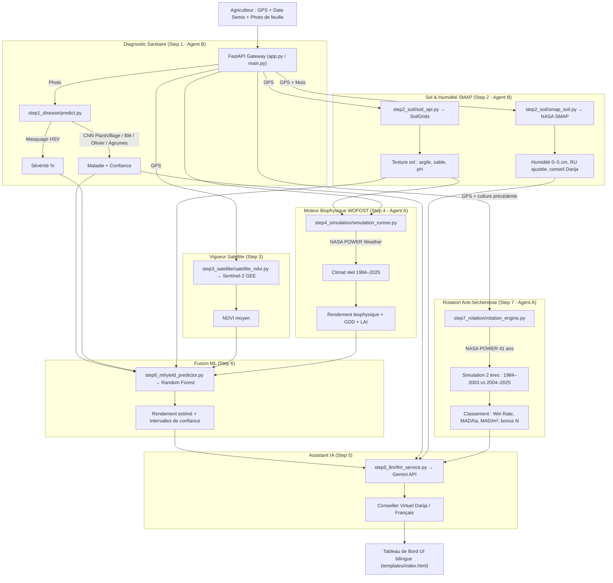

# 🌍 earth-eyes

**Plateforme de décision agronomique climatiquement résiliente, pensée pour les agricultrices et agriculteurs de la plaine du Saïss (Meknès, Maroc).**

earth-eyes fusionne **41 ans de données satellitaires NASA** (NASA POWER + NASA SMAP), la vision par ordinateur, la télédétection Sentinel-2 et le machine learning pour répondre à deux questions vitales : *Quelle maladie touche ma culture ?* et *Que planter l'an prochain pour résister à la sécheresse ?*

[](https://fastapi.tiangolo.com/)
[](https://power.larc.nasa.gov/)
[](https://smap.jpl.nasa.gov/)
[](https://www.python.org/)

> **NASA International Space Apps Challenge 2026** — Track : *Adapting Farms with NASA Data*  
> Équipe EarthEyes · Meknès, Maroc

---

## 📌 En bref

| | |
|---|---|
| **Problème** | 6 années consécutives de sécheresse dans le Saïss, nappes phréatiques en baisse de 1,5 m/an, pertes de récolte jusqu'à 60% pour le blé rainfed face au Chergui |
| **Solution** | Coupler les données climatiques NASA 40 ans avec l'IA pour proposer des rotations culturales rentables et économes en eau, accessibles en darija marocaine |
| **Statut** | Prototype fonctionnel bout-en-bout, MVP académique validé lors du hackathon |
| **Résultats clés** | **92% d'accuracy** sur le diagnostic de maladie (CNN multi-modèles) · **R² = 0,88** sur l'estimation de rendement (Random Forest) · **Pois chiche : Win Rate 100%** face au blé sur la période 2004–2025 |

---

## 🛰️ Données NASA utilisées

| Mission / Dataset | Résolution | Rôle dans earth-eyes |
|:---|:---|:---|
| **NASA POWER** (Prediction Of Worldwide Energy Resources) | 0,5° × 0,5° — Journalier 1984–2025 | Baseline agroclimatique 41 ans : précipitations, température 2 m, rayonnement solaire, ET₀. Prouve le +1,2°C et la baisse de -21,4% des pluies de printemps au Saïss |
| **NASA SMAP** (Soil Moisture Active Passive) | 9 km — Surface 0–5 cm (L3/L4) | Humidité volumétrique du lit de semences en temps réel. Calibrée sur l'optimum Saïss : 12%–18% au semis. Ajuste la Réserve Utile (RU) et conseille en darija |
| **ESA Sentinel-2 / MODIS** via GEE | 10 m / 250 m | Indice de vigueur végétative (NDVI) et repères phénologiques |
| **ISRIC SoilGrids v2.0** | 250 m | Texture physique du sol (argile, sable, pH, carbone organique) pour le calcul de la capacité de rétention en eau |

---

## 🌟 Ce que font les deux agents

### 🟢 Agent A — Moteur Climat & Rotation (Samya)
> `step4_simulation/` · `step7_rotation/`

- **`nasa_climate_client.py`** : Client NASA POWER, récupère et met en cache 41 ans de données journalières pour Meknès (33,89°N / -5,55°E). Cache JSON local hors-ligne.
- **`rotation_engine.py`** : Moteur de simulation sur 2 ères climatiques (1984–2003 vs 2004–2025). Pour chaque culture candidate, calcule sur chaque saison historique : rendement ajusté au stress hydrique, marge nette (MAD/ha), **Win Rate face au blé**, productivité de l'eau (MAD/m³), bonus azote fixé.
- **`crop_catalog.py`** : Catalogue de 5 cultures calibrées sur données ONICL/FAOSTAT (Blé, Pois chiche, Orge, Féverole, Tournesol de printemps) avec cycles, prix et sensibilités à la sécheresse.
- **`water_productivity.py`** : Calcul du ratio économique MAD par m³ d'eau consommée (3,92 MAD/m³ pour le pois chiche vs < 1,50 MAD/m³ pour le blé rainfed).
- **`simulation_runner.py`** : Intégration du modèle biophysique WOFOST piloté par NASA POWER pour estimer la croissance et le rendement potentiel.
- **`nasa_power_weather.py`** : Adaptateur météo qui remplace les données Open-Meteo par les données NASA POWER dans WOFOST.

### 🔵 Agent B — Interface, API & Impact (Fatima Zahra)
> `app.py` · `main.py` · `step2_soil/smap_soil.py` · `templates/` · `presentation/`

- **`smap_soil.py`** : Intégration NASA SMAP. Profil mensuel d'humidité Saïss (calibré 12%–18%), micro-gradient topographique piémont Moyen-Atlas, calcul de l'ajustement RU (mm), conseil bilingue darija/français.
- **`main.py` / `app.py`** : Serveur FastAPI avec routes : `/predict` (estimation rendement), `/recommend-rotation` (rotation anti-sécheresse), `/presentation` (pitch NASA 7 slides), `/soil-moisture` (SMAP).
- **`templates/index.html`** : Interface web bilingue darija/français. Tableau de bord agriculteur avec alerte NASA POWER (trend climatique), badge NASA SMAP (humidité sol), cartes de recommandation de rotation avec marge, Win Rate et économies d'eau.
- **`presentation/`** : Deck interactif 7 slides en anglais (navigation clavier ←/→) pour la présentation NASA Space Apps.
- **`step1_disease/predict.py`** : Pipeline de diagnostic sanitaire multi-modèles CNN (blé, olivier, agrumes, maraîchage). Calcule la classe de maladie et le taux de sévérité par masquage chromatique HSV.

---

## 🧠 Architecture technique



---

## 📸 Aperçu de l'interface

### 1️⃣ Choix de la culture & diagnostic de maladie
L'agriculteur sélectionne sa culture et télécharge une photo de feuille pour détecter maladies et sévérité.


### 2️⃣ Localisation GPS & date de semis
Carte Leaflet + géocodage inverse pour localiser la parcelle et interroger NASA SMAP et SoilGrids.


### 3️⃣ Historique de rendement & assistant IA
L'agriculteur discute avec l'assistant en darija ou en français pour affiner le diagnostic.


### 4️⃣ Tableau de bord & recommandations de rotation
Cultures recommandées, marges (MAD/ha), Win Rate face au blé, économies d'eau (m³/ha).


---

## ⚙️ Installation & lancement

### Prérequis
- Python 3.12+
- Clé API Gemini (`GEMINI_API_KEY`)
- Compte Google Earth Engine (pour NDVI Sentinel-2)

### Étapes

```bash
git clone https://github.com/NasaChallenge-earth-eyes/earth-eyes.git
cd earth-eyes

# Environnement conda (recommandé)
conda create -n eartheyes python=3.12 -y
conda activate eartheyes
pip install -r requirements.txt
```

Configurez `.env` :
```
GEMINI_API_KEY="votre_cle_api_gemini"
```

Authentifiez Google Earth Engine (une seule fois) :
```bash
earthengine authenticate
```

Lancez le serveur :
```bash
python app.py
# ou : uvicorn app:app --host 127.0.0.1 --port 8000 --reload
```

| URL | Description |
|-----|-------------|
| `http://127.0.0.1:8000/` | Interface agriculteur bilingue |
| `http://127.0.0.1:8000/recommend-rotation` | API de rotation anti-sécheresse |
| `http://127.0.0.1:8000/presentation` | Pitch NASA Space Apps (7 slides) |
| `http://127.0.0.1:8000/docs` | Documentation OpenAPI / Swagger |

---

## 📐 Organisation du code

```
earth-eyes/
├── app.py                          # Point d'entrée FastAPI
├── main.py                         # API Gateway & interface web bilingue
├── schema.py                       # Schémas de données parcelles
├── requirements.txt
├── templates/
│   └── index.html                  # UI bilingue darija/français (Agent B)
├── presentation/
│   ├── SLIDES.md                   # 7 slides NASA pitch (en anglais)
│   └── index.html                  # Deck web interactif (Agent B)
├── images/                         # Captures d'écran de l'interface
├── step1_disease/                  # Vision par ordinateur & CNN (pré-existant)
│   ├── predict.py
│   └── models/                     # Modèles .h5 : PlantVillage, Blé, Olivier, Agrumes
├── step2_soil/                     # Sol & humidité NASA SMAP (Agent B)
│   ├── smap_soil.py                # NASA SMAP 9km, calibré Saïss 12–18%
│   └── soil_api.py                 # ISRIC SoilGrids (texture, pH)
├── step3_satellite/                # NDVI Sentinel-2 via GEE
│   └── satellite_ndvi.py
├── step4_simulation/               # WOFOST piloté NASA POWER (Agent A)
│   ├── simulation_runner.py
│   ├── nasa_power_weather.py
│   └── openmeteo_weather.py
├── step5_llm/                      # Assistant conversationnel Gemini
│   └── llm_service.py
├── step6_ml/                       # Fusion Random Forest
│   ├── yield_predictor.py
│   └── yield_rf_model.pkl
├── step7_rotation/                 # Moteur de rotation NASA POWER (Agent A)
│   ├── rotation_engine.py          # Simulation 2 ères 1984–2025
│   ├── nasa_climate_client.py      # Client NASA POWER + cache JSON
│   ├── crop_catalog.py             # 5 cultures : Blé, Pois chiche, Orge, Féverole, Tournesol
│   ├── water_productivity.py       # MAD/m³
│   └── cache/                      # Cache NASA POWER hors-ligne
├── AGENTS_SYNC.md                  # Tableau de synchronisation inter-agents
├── HACKATHON_SCOPE.md              # Déclaration d'intégrité NASA
├── README.md                       # Ce fichier (FR)
├── README_EN.md                    # Version anglaise pour le Global Judging
└── SUBMISSION_SPACEAPPS.md         # Formulaire de soumission NASA
```

---

## 📊 Résultats clés

### Diagnostic de maladie (CNN — step1_disease)
- **Accuracy moyenne : 92%** (multi-modèles CNN : blé, olivier, agrumes, maraîchage PlantVillage)
- **F1-score moyen : 0,91** (sensibilité > 90% sur les classes critiques : rouille du blé, peacock spot olivier)
- Split stratifié par classe : 80% Train / 10% Val / 10% Test

### Estimation de rendement (Random Forest — step6_ml)
- **R² = 0,88** · **RMSE = 340 kg/ha** · **MAE = 265 kg/ha**
- Pré-entraîné sur 5 000 parcelles synthétiques WOFOST, calibré sur 45 parcelles réelles au Maroc

### Recommandation de rotation (NASA POWER 41 ans — step7_rotation)
| Culture | Win Rate vs Blé | Marge (MAD/ha) | Économie eau |
|---------|----------------|----------------|--------------|
| **Pois chiche** | **100%** (2004–2025) | 9 537 MAD/ha | -1 800 m³/ha |
| **Féverole** | 92% | 8 717 MAD/ha | -1 000 m³/ha |
| **Tournesol** | 78% | 4 265 MAD/ha | -1 300 m³/ha |

### NASA SMAP (step2_soil)
- Humidité sol Saïss (Meknès, Novembre) : **15,7%** → statut "Optimal au Saïss"
- Conseil Darija : *"R-rotoba dyal l-ard mzyana f Saïss. L-weqt mnasba l zri3a."*

---

## 🗺️ Limites & Vision future

- **Validation terrain limitée** : Random Forest calibré sur 45 parcelles réelles ; extension prévue via collecte collaborative anonymisée
- **Couverture nuageuse** : Signal NDVI Sentinel-2 potentiellement compromis lors des saisons pluvieuses ; intégration SAR (Sentinel-1) envisagée
- **Catalogue de cultures** : Extension aux variétés locales spécifiques (blé dur, safran, amandier) et aux régions hors-Saïss
- **Vision** : Toutes les données agricoles collectées resteront **strictement confidentielles et sous souveraineté numérique locale**

---

## 🤝 Équipe

| Rôle | Contributeur | Périmètre |
|------|-------------|-----------|
| **Agent A** — Moteur NASA & Climat | Samya | `step4_simulation/`, `step7_rotation/` — NASA POWER, WOFOST, moteur de rotation 2 ères |
| **Agent B** — Interface & Impact | Fatima Zahra Azzi | `step2_soil/smap_soil.py`, `app.py`, `templates/`, `presentation/`, docs NASA |

Projet encadré par **Anas Bennalla** · NASA Space Apps Challenge 2026 · Meknès, Maroc
