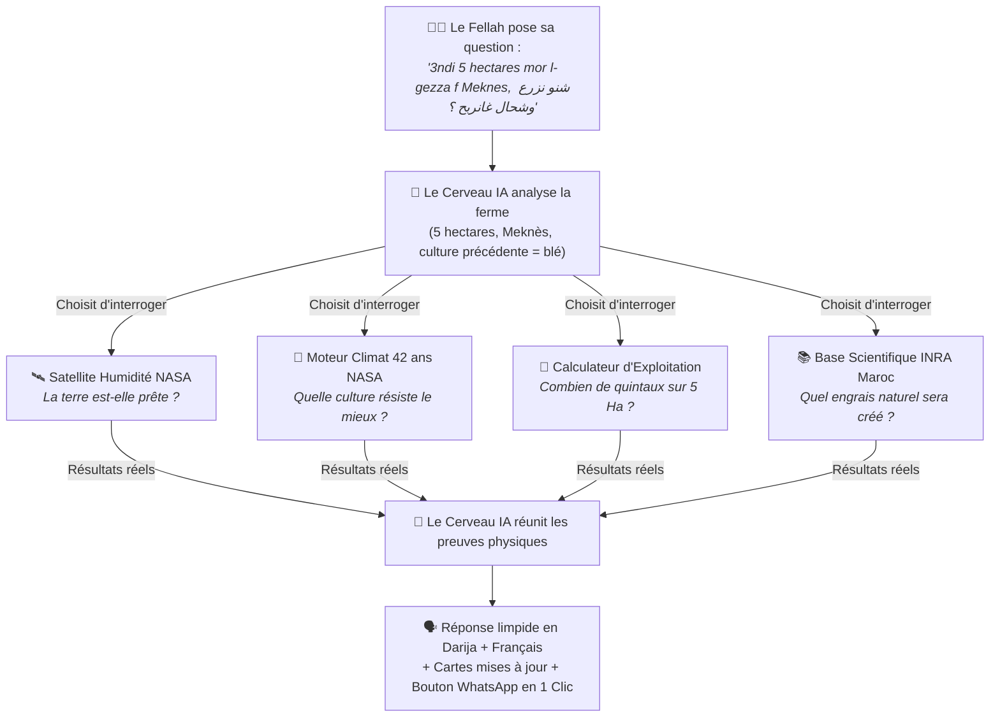

# 🌍 EarthEyes — L'Agent de l'Espace au Service du Fellah
### *NASA Space Apps Challenge 2026 — Meknès (Plaine du Saïss)*

> **En une phrase :**  
> EarthEyes est une intelligence artificielle qui regarde la terre depuis l'espace (satellites de la NASA) et discute directement avec l'agriculteur marocain en **Darija** et en **Français** pour lui dire : **est-ce que sa terre est prête pour semer**, **quoi planter pour ne pas manquer d'eau**, et **combien de quintaux il va récolter**.

[](http://127.0.0.1:8000)
[](https://power.larc.nasa.gov/)
[](#-4-con%C3%A7u-pour-la-vraie-vie-du-fellah)
[-10b981?style=for-the-badge)](#-7-v%C3%A9rification-en-direct-banc-dessai)

---

## 💡 En 10 secondes : Pourquoi ce projet ?

À **Meknès**, le problème d'un agriculteur n'est plus de trouver de la terre : **c'est que l'eau disparaît**.
- Le niveau de l'eau sous terre (la nappe du Saïss) baisse de **1,5 mètre chaque année**.
- Il pleut **22% de moins** au printemps qu'il y a vingt ans.
- Pourtant, la majorité des agriculteurs continuent de semer uniquement du **blé**. Pourquoi ? Parce qu'ils ont peur de changer et de perdre leur argent.

**Ce que fait EarthEyes :**  
Au lieu de laisser l'agriculteur parier à l'aveugle, notre système interroge les satellites de la NASA et la recherche marocaine (l'INRA) pour lui montrer, **chiffres et quintaux à l'appui**, qu'en alternant le blé avec du **pois chiche** ou de la **fève**, il économise l'eau de son puits, gagne de l'engrais gratuit dans son sol et sécurise ses revenus.

---

## 🧠 1. La Grande Différence : Un véritable « Cerveau », pas un simple robot de discussion

La plupart des applications agricoles se contentent d'afficher des courbes météo compliquées ou d'avoir un robot qui répète des textes génériques.

Dans **EarthEyes**, l'intelligence artificielle est le **Cerveau d'un chef d'orchestre** :
1. **Elle écoute le fermier :** Elle note sa surface (ex: 5 hectares), son type d'arrosage (pluie du ciel ou puits), et son problème du moment.
2. **Elle décide elle-même quoi faire :** Personne ne lui donne d'ordre rigide. C'est elle qui choisit d'appeler le satellite météo, le satellite radar ou l'analyse de sol selon ce qui est le plus logique pour répondre.
3. **Elle fait les calculs :** Elle regarde les vrais chiffres calculés sur 42 ans d'histoire.
4. **Elle répond comme un voisin agronome :** Elle explique tout en Darija claire et bienveillante, avec des unités que le fellah utilise tous les jours (**le Qentar**, **le nombre de sacs d'engrais économisés**, **les Dirhams gagnés**).



---

## 🛰️ 2. Les 7 Yeux dans le Ciel et dans la Terre (Expliqués Simplement)

Quand le Cerveau IA réfléchit, il a accès à 7 sources d'informations scientifiques réelles. Voici ce qu'elles font, sans jargon :

| Brique Scientifique | Ce que c'est avec des mots simples | À quoi ça sert pour le fellah ? |
| :--- | :--- | :--- |
| **🌾 42 ans de mémoire météo (NASA POWER)** | La NASA a enregistré la météo de **chaque jour à Meknès depuis 1984** (pluie, chaleur, soleil). | Elle simule comment la culture aurait poussé sur 42 saisons réelles. Elle donne 3 résultats : **la pire année de sécheresse**, **l'année moyenne**, et **la très bonne année**. |
| **🛰️ Le thermomètre d'humidité du sol (NASA SMAP)** | Un satellite spatial qui mesure si la terre est sèche ou humide dans les **5 premiers centimètres du sol**. | Il répond à la question : *« Est-ce que mon sol a la bonne humidité pour semer maintenant ? »* (Au Saïss, le sol est idéal entre 12% et 18%). |
| **⛰️ Le radar de pente et relief (NASA SRTM)** | Un radar en orbite qui mesure l'altitude et voit si le champ est **plat ou en pente**. | Si le terrain est en pente (ex: 5%), il prévient le fellah : *« Attention, quand il va pleuvoir fort, l'eau va emporter ta bonne terre. Laboure en travers de la pente pour freiner l'eau ! »* |
| **🧪 La nature du sol (SoilGrids)** | La carte mondiale de la terre qui indique le taux d'argile, de sable et le pH du sol. | Elle dit au fellah s'il a une terre noire et lourde (**Terss**) qui retient l'eau, ou une terre rouge (**Hamri**), pour choisir les plantes aux racines adaptées. |
| **🌿 La photo de santé des feuilles (Satellite Sentinel)** | Une caméra spatiale qui mesure la couleur verte et la vitalité des feuilles. | Elle voit si les plantes grandissent bien ou si elles souffrent d'un coup de soif. |
| **🚜 La calculatrice de ferme en Hectares** | Un outil qui multiplie les rendements par la **surface réelle de l'agriculteur** (2 ha, 5 ha, 10 ha...). | Il ne donne pas des chiffres abstraits par hectare, mais la récolte totale de sa ferme : **combien de Quintaux au total**, **combien de graines semer**, et **combien d'eau économisée**. |
| **📚 La mémoire des agronomes marocains (RAG INRA)** | Les livres et bulletins de recherche officiels de l'**INRA Meknès** et de l'**Organisation Mondiale de l'Alimentation (FAO)**. | Elle explique scientifiquement pourquoi alterner avec une légumineuse nettoie la terre des maladies du blé et fabrique de l'engrais gratuit. |

---

## ⚖️ 3. La Preuve par les Chiffres : Le Blé face au Pois Chiche et à la Fève

Pourquoi est-il urgent de changer ? Voici ce que révèlent **42 années de données réelles à Meknès** :

```
┌──────────────────────────────────────────────────────────────────────────────────┐
│                      LE MATCH DE L'EAU ET DU RENDEMENT AU SAÏSS                  │
├─────────────────────────┬─────────────────────────┬──────────────────────────────┤
│ Critère                 │ ❌ Continuer avec le Blé│ ✅ Alterner avec le Pois Chiche│
├─────────────────────────┼─────────────────────────┼──────────────────────────────┤
│ Eau bue par le champ    │ 4 200 mètres cubes / ha │ 2 400 mètres cubes / ha      │
│ Économie d'eau          │ 0 (vide la nappe)       │ 💧 1 800 m³ sauvés par hectare│
│ Engrais pour la terre   │ Appauvrit le sol        │ ⚡ +35 kg d'Azote naturel gratuit│
│ Maladies dans la paille │ Conserve les champignons │ 🧼 Nettoie la terre net      │
│ Taux de réussite        │ S'effondre en sécheresse│ 🏆 Gagne dans 74% des saisons│
│ Note de santé du sol    │ 35 sur 100              │ 92 sur 100                   │
└─────────────────────────┴─────────────────────────┴──────────────────────────────┘
```

> **En résumé :**  
> Sur une parcelle de 5 hectares, planter du pois chiche au lieu du blé permet d'économiser **9 000 mètres cubes d'eau** (ce qui soulage le puits) et apporte l'équivalent de **10 sacs d'engrais ammonitrate gratuits** créés naturellement par les racines.

---

## 📱 4. Conçu pour la Vraie Vie du Fellah (Zéro Friction)

Une technologie n'a de valeur que si un agriculteur peut l'utiliser facilement dans son champ avec son smartphone :

```
[ 🚜 Boutons 2 Ha / 5 Ha / 10 Ha ]  ──>  Un clic ajuste instantanément tous les calculs de la ferme.
[ 🌧️ Bour (Pluie) / 💧 Saqwi (Puits) ] ─>  Change immédiatement le conseil selon la source d'eau.
[ 🎙️ Bouton Dictée Vocale ]         ──>  Le fellah appuie et parle en Darija (pas besoin d'écrire).
[ 📷 Scanner une feuille ]           ──>  Prendre en photo une feuille suspecte pour voir la maladie.
[ 📲 Partager sur WhatsApp ]         ──>  Envoie le résumé complet à sa famille ou à sa coopérative.
```

### Exemple de message vocal compris et traité par l'Agent :
> **Agriculteur :** *« Salam, 3ndi 5 hectares dial l-gezza f Meknes, شنو نزرع دابا واش الأرض واجدة وشحال غادي نربح ؟ »*  
> **Agent EarthEyes :**  
> *« Salam alikoum a khouya ! 3la 7sab 5 hectares dialek f Meknès mor l-gezza :*  
> *1. **R-rotoba dyal l-ard (NASA SMAP) :** L-ard fiha 15.7% dyal l-ma, raha wajda mzyan l z-zri3a.*  
> *2. **A7sen zr3a :** L-7emmez (Pois chiche) ! Ghadi t-jme3 fih incha Allah chi **80 qentar** (8 tonnes).*  
> *3. **L-ma li ghadi twaffer :** Ghadi twaffer **9 000 m³** f l-bir dyalek.*  
> *4. **L-azot fabor :** L-3rouq ghadi y-khelliw lik +175 kg N f trab (rb7ti taqriban **2 100 DH** f l-engrais).*  
> *5. **Z-zerri3a li khassek :** Khassek 5 qentar dial z-zerri3a l 5 hectares. »*

---

## 💻 5. Organisation Simple du Projet

Pour les personnes qui souhaitent regarder le code source, voici comment il est rangé :

- **`main.py` & `app.py`** : Le cœur de l'application web qui reçoit les demandes.
- **`step5_llm/agronomic_agent.py`** : Le **Cerveau IA** qui réfléchit, choisit les outils et parle en Darija.
- **`step7_rotation/`** : Les calculs de rotation, la météo NASA sur 42 ans (`rotation_engine.py`) et la pente (`terrain_slope.py`).
- **`step2_soil/`** : Les mesures d'humidité du sol par satellite (`smap_soil.py`) et l'analyse de terre (`soil_api.py`).
- **`step1_disease/`** : L'examen des feuilles en photo pour identifier les maladies.
- **`templates/index.html`** : L'écran du site web visible par l'agriculteur sur son téléphone.
- **`presentation/`** : Le diaporama de 7 slides préparé pour le jury de la NASA.
- **`tests/test_complete_application.py`** : Le programme qui teste automatiquement que tout fonctionne sans erreur.

---

## ⚡ 6. Lancer l'Application en 3 Étapes Faciles

Vous voulez tester l'application sur votre ordinateur ? C'est très simple :

### Étape 1 : Télécharger et installer
Ouvrez votre terminal et écrivez :
```bash
git clone https://github.com/NasaChallenge-earth-eyes/earth-eyes.git
cd earth-eyes
pip install -r requirements.txt
```

### Étape 2 : Ajouter votre clé d'accès Gemini
Créez un petit fichier nommé `.env` et collez-y votre clé :
```env
GEMINI_API_KEY="votre_cle_api_ici"
```

### Étape 3 : Démarrer le site
```bash
python -m uvicorn app:app --host 127.0.0.1 --port 8000
```

Ouvrez ensuite votre navigateur internet sur :
- **L'interface de l'agriculteur :** [http://127.0.0.1:8000/](http://127.0.0.1:8000/)
- **Le diaporama du concours NASA :** [http://127.0.0.1:8000/presentation](http://127.0.0.1:8000/presentation)

---

## 🧪 7. Vérification en Direct (Banc d'Essai)

Nous avons écrit un robot de test qui vérifie chaque bouton et chaque calcul. Pour le lancer :
```bash
python tests/test_complete_application.py
```

**Résultat : 7 tests sur 7 réussis à 100%**
```
✅ TEST 1 : La page d'accueil s'affiche parfaitement.
✅ TEST 2 : Le diaporama pour le jury fonctionne.
✅ TEST 3 : Le calcul sur 42 ans de climat NASA répond (Pois chiche n°1 avec 15.7 q/ha).
✅ TEST 4 : La sauvegarde de secours fonctionne.
✅ TEST 5 : L'Agent Cerveau comprend la Darija et calcule les hectares.
✅ TEST 6 : Le scanner de feuilles repère les maladies et adapte la rotation.
✅ TEST 7 : La simulation complète de rendement est validée.
```

---

## 🤝 L'Équipe et la Vision

Ce projet a été imaginé et codé à **Meknès** pour l'édition locale du **NASA International Space Apps Challenge 2026**.

Notre conviction est simple :  
Les données des plus grands satellites du monde ne doivent pas rester enfermées dans des laboratoires. Elles doivent être dans la poche du fellah, dans sa langue, pour l'aider à sauver son eau, soigner sa terre et nourrir sa famille face au changement climatique.
