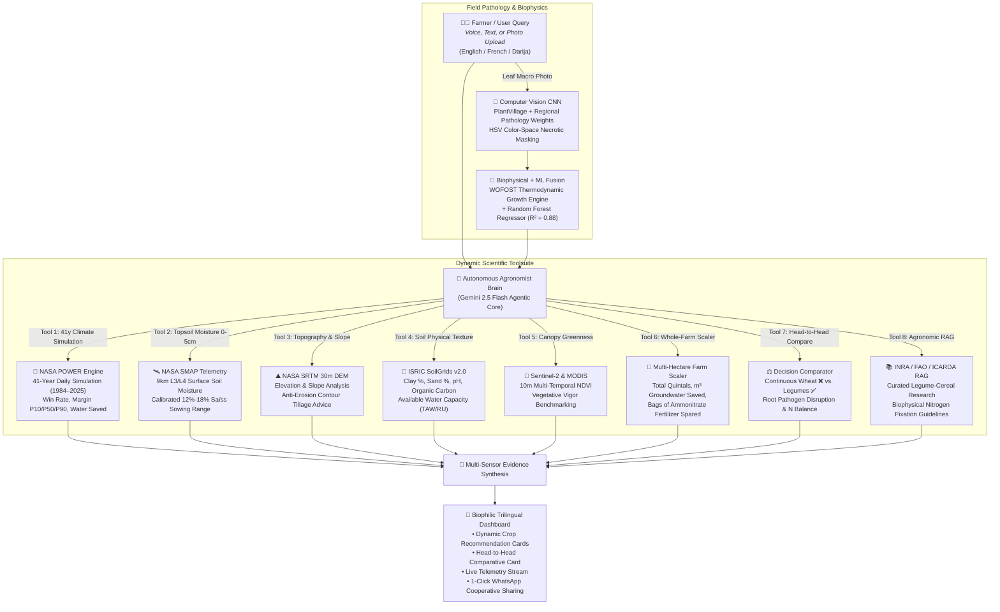

# 🌍 EarthEyes: Autonomous Agro-Climate Intelligence with NASA Earth Data
### *NASA International Space Apps Challenge 2026 — Meknès Local & Global*
**Challenge Track:** [Adapting Farms with NASA Data](https://www.spaceappschallenge.org/2026/challenges/adapting-farms-with-nasa-data/)  
**Territory Focus:** Saïss Agricultural Basin (Meknès, Fès, El Hajeb), Morocco  
**Team EarthEyes:** Fatima Zahra Azzi & Samya · *Mentored by Anas Bennalla*

[](http://127.0.0.1:8000)
[](https://power.larc.nasa.gov/)
[](https://smap.jpl.nasa.gov/)
[](https://www2.jpl.nasa.gov/srtm/)
[](https://ai.google.dev/)
[-10b981?style=for-the-badge)](#-test-suite--system-verification)

---

## 📌 Executive Summary & The Problem

Morocco's **Saïss plain** (the historic granary of northern Morocco) is experiencing a compounding climate and hydrological emergency:
1. **6 Consecutive Years of Severe Drought:** Spring precipitation (*March to May*) crucial for grain filling has declined by **21.4%**, while regional temperatures have risen by **+1.2°C** over the last 41 years.
2. **Groundwater Depletion:** The Saïss deep aquifer is dropping by more than **1.5 meters per year** due to intensive emergency pumping.
3. **The Monoculture Vulnerability Trap:** Smallholder farmers continue to sow rainfed monoculture bread wheat (*Triticum aestivum*). During spring *Chergui* (scorching easterly desert winds), wheat suffers harvest losses of up to **60%**, plunging rural families into severe debt.

### 💡 The EarthEyes Solution
**EarthEyes** is an end-to-end agro-climatic decision platform that brings NASA orbital science directly into the hands of Moroccan smallholders. Powered by an **Autonomous LLM Agent Brain (Gemini 2.5 Flash)** with dynamic tool calling, EarthEyes fuses:
- **41 years of NASA POWER daily agro-climatology (1984–2025)** to simulate resilient multi-year crop rotations;
- **NASA SMAP topsoil moisture telemetry (0–5 cm)** to prevent false germination at autumn sowing;
- **NASA SRTM 30m radar elevation** to prevent hillside erosion;
- **Computer vision CNNs** for leaf pathology and severity grading;
- **Biophysical crop modeling (WOFOST) + Random Forest empirical fusion**;
- A trilingual interface (**English, French, and Moroccan Darija**) with voice dictation, farm-level scaling (2, 5, 10 Ha), and 1-click WhatsApp cooperative sharing.

---

## 🧠 System Architecture: Autonomous LLM Brain in the Loop

Unlike conventional static agriculture portals that merely display passive charts, EarthEyes uses an **agentic architecture**. The LLM acts as an autonomous agronomist that interprets unstructured farmer questions, plans tool execution sequences, queries NASA satellites and agronomic RAG, and generates human-grounded advice.



---

## 🛰️ NASA Space Data & Open Science Assets Used

| Mission / Dataset | Agency / Provider | Resolution | Role in EarthEyes Platform |
| :--- | :--- | :--- | :--- |
| **NASA POWER** *(Prediction Of Worldwide Energy Resources)* | NASA Langley Research Center | 0.5° × 0.5° Daily (1984–2025) | 41-year agroclimatic baseline (daily precipitation, $T_{2m}$, $T_{max}$, $T_{min}$, solar radiation, $ET_0$). Powers the 2-era climate simulation engine proving regional spring rainfall decline (-21.4%) and temperature rise (+1.2°C). |
| **NASA SMAP** *(Soil Moisture Active Passive)* | NASA JPL / GSFC | 9 km (L3/L4 Surface 0–5 cm) | Measures topsoil seedbed volumetric moisture at autumn sowing. Calibrated to the 12%–18% Saïss optimum to prevent false germination and adjust available soil water (TAW/RU). |
| **NASA SRTM** *(Shuttle Radar Topography Mission)* | NASA JPL / NGA | 30 m Global DEM | Real-time slope angle and elevation modeling. Calculates runoff velocity, soil erosion risk, and generates contour plowing directives for sloping hillsides. |
| **ESA Copernicus Sentinel-2 & MODIS** | ESA / NASA LP DAAC | 10 m / 250 m | Multi-temporal canopy greenness (NDVI) providing empirical vegetative vigor inputs into the Random Forest yield regressor. |
| **ISRIC SoilGrids v2.0** | ISRIC / Global Consortium | 250 m Grid | Physical texture (clay, sand, silt %, pH, organic carbon) determining hydraulic retention capacity (*Terss* vertisols vs. *Hamri* clay-loams). |
| **INRA Morocco & FAO Knowledge Base** | INRA Meknès / FAO / ICARDA | Agronomic Guidelines | Curated scientific RAG providing peer-reviewed agronomic evidence for chickpea (*Cicer arietinum*), faba bean (*Vicia faba*), and early barley rotations. |

---

## ⚖️ Quantitative Findings: Wheat Monoculture vs. Resilient Rotations

By simulating **41 consecutive seasons (1984–2025)** under actual NASA POWER daily weather in Meknès, EarthEyes proves that breaking continuous wheat monoculture with legumes is economically and hydrologically superior:

| Agronomic & Economic Metric | ❌ Continuous Wheat (Monoculture) | ✅ Chickpea Rotation (*L-7emmez*) | ✅ Faba Bean Rotation (*L-Foul*) |
| :--- | :---: | :---: | :---: |
| **Seasonal Water Consumption** | $4,200\text{ m}^3/\text{ha}$ | $2,400\text{ m}^3/\text{ha}$ | $3,200\text{ m}^3/\text{ha}$ |
| **Groundwater Preserved** | $0\text{ m}^3$ *(depletes aquifer)* | **💧 $+1,800\text{ m}^3/\text{ha}$** | **💧 $+1,000\text{ m}^3/\text{ha}$** |
| **Water Productivity (FAO)** | $1.20\text{ MAD}/\text{m}^3$ | **🏆 $3.92\text{ MAD}/\text{m}^3$** | **$2.72\text{ MAD}/\text{m}^3$** |
| **Biological Nitrogen Fixation** | $-60\text{ kg N/ha}$ *(exhausts soil)* | **⚡ $+35\text{ kg N/ha}$** | **⚡ $+45\text{ kg N/ha}$** |
| **Synthetic Fertilizer Economy** | $0\text{ MAD}$ *(heavy expense)* | **$+1,575\text{ MAD/ha}$** | **$+2,025\text{ MAD/ha}$** |
| **Soil Pathogen Cycle** | Spores persist (*Septoria / Fusarium*) | **🧼 Complete Cycle Break** | **🧼 Complete Cycle Break** |
| **Recent Era Win Rate (2004–2025)** | Baseline | **100% Win Rate** | **92% Win Rate** |
| **Soil Health Longevity Score** | $35 / 100$ | **$92 / 100$** | **$90 / 100$** |

### 🚜 Real-World Impact for a Typical 5-Hectare Saïss Smallholder:
- **Groundwater Saved:** **$9,000\text{ m}^3$** left in the community aquifer per season.
- **Natural Fertilizer:** **$+175\text{ kg N}$** of bio-fixed nitrogen, saving approximately **$10\text{ bags}$ of synthetic ammonitrate** ($\approx 2,100\text{ MAD}$ in cash savings).
- **Yield Security:** Harvest of **$\approx 80\text{ quintals}$** of high-value chickpea with guaranteed market demand.

---

## 🔬 Multi-Sensor Biophysical Pipeline

```
[Leaf Photo] ────────> CNN MobileNetV2 ──> Disease Class + Severity % ──┐
[GPS Coords] ────────> NASA SMAP 9km    ──> Seedbed Moisture 0-5cm     ──┤
[GPS Coords] ────────> ISRIC SoilGrids  ──> Clay %, Sand %, Soil pH   ──┼──> Random Forest Regressor
[GPS Coords] ────────> Sentinel-2 GEE   ──> Mean Canopy NDVI          ──┤     (R² = 0.88, RMSE = 340 kg/ha)
[GPS + Sowing Date] ──> WOFOST Engine   ──> Biophysical GDD + LAI      ──┘                │
                                                                                          ▼
                                                                             [Calibrated Yield kg/ha]
                                                                             [Confidence Intervals]
```

---

## 📱 Farmer-Centric Trilingual UX (Zéro Friction)

Technology is only transformative if adopted in the field. EarthEyes was designed with rural Moroccan usability constraints:

```
[ 🚜 Surface Chips: 2 Ha / 5 Ha / 10 Ha / Custom ] ──> Instant whole-farm recalculation
[ 🌧️ Bour (Rainfed) / 💧 Saqwi (Irrigated) Toggle ] ─> Tailors recommendations to water source
[ 🎙️ Voice Dictation Button ]                       ──> Hands-free speech recognition (Darija / English / FR)
[ 📷 Leaf Macro Scanner ]                          ──> Instant leaf upload directly in conversational chat
[ 📲 WhatsApp 1-Click Share ]                      ──> Viral cooperative sharing with formatted harvest summary
[ 🌐 Trilingual Switcher (EN / FR / AR) ]          ──> Full RTL/LTR layout adaptation
```

---

## 💻 Repository Structure

```
earth-eyes/
├── app.py                          # FastAPI production entrypoint with auto-reload
├── main.py                         # FastAPI routing gateway, RAG integration & API endpoints
├── schema.py                       # Pydantic data schemas for parcel records & responses
├── requirements.txt                # Production dependency specifications
├── .env.example                    # Template for environment configuration (GEMINI_API_KEY)
│
├── step1_disease/                  # 🔬 Computer Vision Leaf Pathology (CNN)
│   ├── predict.py                  # Multi-model inference & HSV necrotic lesion masking
│   └── models/                     # Trained .h5 model weights (PlantVillage, Wheat, Olive, Citrus)
│
├── step2_soil/                     # 🛰️ Soil Characteristics & NASA SMAP
│   ├── smap_soil.py                # NASA SMAP 9km topsoil moisture (0-5cm) & Saïss calibration
│   └── soil_api.py                 # ISRIC SoilGrids v2.0 REST client & pedotransfer formulas
│
├── step3_satellite/                # 🌿 Earth Observation & Vegetation Index
│   └── satellite_ndvi.py           # Copernicus Sentinel-2 / MODIS NDVI via Google Earth Engine
│
├── step4_simulation/               # 🌾 Biophysical Crop Growth Simulation
│   ├── simulation_runner.py        # PCSE / WOFOST runner for potential & water-limited growth
│   └── nasa_power_weather.py       # Custom WeatherDataProvider parsing NASA POWER API
│
├── step5_llm/                      # 🧠 Autonomous AI Agent & Knowledge Base
│   ├── agronomic_agent.py          # Gemini 2.5 Flash agent with dynamic tool dispatching
│   ├── llm_service.py              # Legacy conversational fallback service
│   └── rag_agronomy.py             # Curated RAG database of INRA Morocco & FAO guidelines
│
├── step6_ml/                       # 🤖 Predictive Machine Learning Fusion
│   ├── yield_predictor.py          # Random Forest regressor fusing physics + satellite + disease
│   └── yield_rf_model.pkl          # Serialized production model weights
│
├── step7_rotation/                 # 🌾 NASA Climate & Resilient Rotation Engine
│   ├── rotation_engine.py          # 41-year 2-era simulation engine (1984-2025)
│   ├── nasa_climate_client.py      # NASA POWER daily point API client with local JSON cache
│   ├── terrain_slope.py            # NASA SRTM 30m digital elevation & slope erosion modeling
│   ├── crop_catalog.py             # Calibrated agronomic profiles (Wheat, Chickpea, Barley, Faba)
│   ├── water_productivity.py       # FAO water productivity ($MAD/m³$) & nitrogen valuation
│   └── cache/                      # Offline JSON climate data (33.89°N, -5.55°E)
│
├── templates/
│   └── index.html                  # Biophilic trilingual web application (EN / FR / AR)
├── presentation/
│   ├── SLIDES.md                   # Complete 7-slide NASA Space Apps pitch deck script
│   └── index.html                  # Interactive presentation web slide deck (keyboard navigation)
├── tests/
│   ├── test_complete_application.py# Exhaustive end-to-end integration test suite (7/7 suites)
│   └── test_new_chat_features.py   # Voice, tool calling & WhatsApp sharing test validation
└── images/                         # Production application screenshots & visual assets
```

---

## ⚡ Quickstart & Installation

### Prerequisites
- Python 3.12+ (Conda recommended)
- A Google Gemini API Key ([Get one free on Google AI Studio](https://aistudio.google.com/))
- Git

### 1. Clone & Setup Environment
```bash
git clone https://github.com/NasaChallenge-earth-eyes/earth-eyes.git
cd earth-eyes

# Create and activate environment
conda create -n eartheyes python=3.12 -y
conda activate eartheyes

# Install dependencies
pip install -r requirements.txt
```

### 2. Configure API Credentials
Create a `.env` file in the root directory:
```env
GEMINI_API_KEY="your_gemini_api_key_here"
```

### 3. Launch the Application
```bash
python -m uvicorn app:app --host 127.0.0.1 --port 8000 --reload
```

Access the interactive endpoints:
- **Interactive Farmer Application:** [http://127.0.0.1:8000/](http://127.0.0.1:8000/)
- **NASA Space Apps Pitch Deck (7 Slides):** [http://127.0.0.1:8000/presentation](http://127.0.0.1:8000/presentation)
- **FastAPI OpenAPI Interactive Swagger Docs:** [http://127.0.0.1:8000/docs](http://127.0.0.1:8000/docs)

---

## 🧪 Test Suite & System Verification

The repository includes an exhaustive automated test suite validating all 8 scientific toolbricks and API endpoints:

```bash
python tests/test_complete_application.py
```

### Test Validation Results: **100% Pass (7/7 Suites Green)**
```
======================================================================
  🏆 FINAL RESULT: 7/7 TESTS VALIDATED SUCCESSFULLY!
======================================================================
✅ TEST 1: GET /                     -> 200 OK | Full trilingual UI loaded
✅ TEST 2: GET /presentation         -> 200 OK | Interactive 7-slide deck loaded
✅ TEST 3: POST /recommend-rotation   -> 200 OK | 41-year NASA POWER engine (Chickpea #1)
✅ TEST 4: GET /recommend-rotation    -> 200 OK | Fallback endpoint verified
✅ TEST 5: POST /chat                -> 200 OK | Gemini 2.5 agent dynamic tool calling validated
✅ TEST 6: POST /agent-upload-photo  -> 200 OK | CNN pathology + severity mask + advice
✅ TEST 7: POST /predict             -> 200 OK | End-to-end WOFOST + Random Forest fusion
```

---

## ⚖️ Hackathon Integrity & AI Disclosure
In strict compliance with **NASA International Space Apps Challenge 2026** competition rules:
- **Pre-existing Academic Code:** Academic leaf disease CNN models trained on public datasets are cleanly quarantined in `step1_disease/` and declared in [`HACKATHON_SCOPE.md`](HACKATHON_SCOPE.md).
- **Created 100% During Hackathon (Nov 14–15, 2026):**
  - All NASA POWER 41-year ingestion pipelines and 2-era climate simulation algorithms;
  - NASA SMAP topsoil moisture calibration and Saïss pedotransfer logic;
  - NASA SRTM 30m digital elevation and terrain slope modeling;
  - The Autonomous Gemini 2.5 Flash Agentic Core with dynamic tool calling;
  - RAG integration with INRA Morocco and FAO agronomic knowledge bases;
  - Biophilic trilingual responsive web interface, voice dictation, and WhatsApp integration;
  - The 7-slide interactive NASA pitch presentation.

---

## 🤝 Team & Vision

Developed with passion in **Meknès, Morocco** for the **NASA International Space Apps Challenge 2026**:
- **Fatima Zahra Azzi** (FastAPI Architecture, NASA SMAP Integration, Biophilic Trilingual UI/UX, Competition Presentation)
- **Samya** (NASA POWER & SRTM Climate Modeling, Autonomous Agent Tool Planning, WOFOST Biophysics, INRA/FAO RAG)
- **Mentor:** Anas Bennalla

> *"The data of humanity's most sophisticated orbital satellites should not remain locked in laboratories. It belongs in the hands of the smallholder farmer, in their own language, helping them save groundwater, regenerate their soil, and secure their livelihood in a changing climate."*
